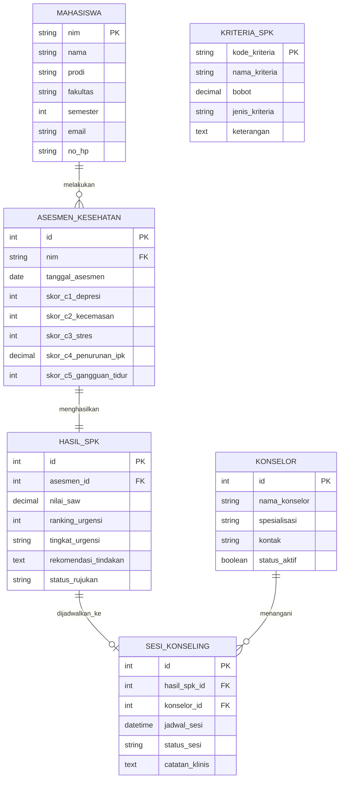

# SIM-KEMAS: Sistem Informasi Manajemen Kesehatan Mental Mahasiswa (Decision Support System)

Sistem Informasi Manajemen dan Pendukung Keputusan (SPK) untuk triase kesehatan mental mahasiswa berbasis instrumen psikometrik standar **DASS-21** (*Depression Anxiety Stress Scales*) dan metode **Simple Additive Weighting (SAW) / TOPSIS**.

---

## 1. Latar Belakang & Ide Sistem Informasi

### Permasalahan
* Peningkatan prevalensi kecemasan, depresi, dan stres akademik di kalangan mahasiswa sering kali terlambat terdeteksi.
* Rasio ketersediaan psikolog/konselor kampus berbanding jumlah mahasiswa sangat timpang (kuota layanan konseling terbatas).
* Belum adanya sistem triase objektif untuk menentukan mahasiswa mana yang berada pada fase darurat (*high-risk/crisis*) dan membutuhkan penanganan segera vs mahasiswa yang cukup dengan pendampingan berkala (*peer support*).

### Solusi Sistem Informasi
**SIM-KEMAS** mengintegrasikan:
1. **Self-Screening Portal**: Mahasiswa mengisi kuesioner instrumen berkala secara aman dan konfidensial.
2. **Clinical Decision Support Engine (SPK)**: Mengalkulasi skor multidimensi (Depresi, Kecemasan, Stres, Penurunan IPK, dan Gangguan Fungsi Harian/Tidur) secara otomatis.
3. **Triase & Konseling Dashboard**: Membantu biro kemahasiswaan/konselor memprioritaskan antrean intervensi (Prioritas 1: Kritis < 24 Jam, Prioritas 2: Tinggi, Prioritas 3: Sedang, Prioritas 4: Normal/Preventif).

---

## 2. Metodologi SPK (Simple Additive Weighting - SAW)

### Kriteria & Pembobotan ($W$)
Semua kriteria berjenis **Benefit** (semakin tinggi nilainya, semakin tinggi urgensi intervensi yang dibutuhkan).

| Kode | Kriteria | Sumber / Instrumen | Rentang Nilai | Jenis | Bobot ($w_j$) |
|---|---|---|---|---|---|
| **C1** | Tingkat Depresi | DASS-21 Subscale Depression | 0 – 42 | Benefit | **25% (0.25)** |
| **C2** | Tingkat Kecemasan | DASS-21 Subscale Anxiety | 0 – 42 | Benefit | **25% (0.25)** |
| **C3** | Tingkat Stres | DASS-21 Subscale Stress | 0 – 42 | Benefit | **20% (0.20)** |
| **C4** | Penurunan IPK Semester Ini | Data Akademik Mahasiswa | 0.00 – 2.00 | Benefit | **15% (0.15)** |
| **C5** | Gangguan Tidur & Fungsi Harian | Skala Kualitas Hidup (Likert) | 1 – 5 | Benefit | **15% (0.15)** |

$$\sum_{j=1}^5 w_j = 0.25 + 0.25 + 0.20 + 0.15 + 0.15 = 1.00$$

### Rumus Normalisasi & Preferensi
1. **Normalisasi Matriks ($R$)**:
   $$r_{ij} = \frac{x_{ij}}{\max_i (x_{ij})}$$
2. **Nilai Preferensi Urgensi ($V_i$)**:
   $$V_i = \sum_{j=1}^n w_j \cdot r_{ij}$$

### Threshold Kategori Urgensi
* **$V_i \ge 0.70$ $\rightarrow$ Prioritas 1 (Kritis / Darurat)**: Rujukan segera ke Psikolog Kampus (< 24 Jam).
* **$0.50 \le V_i < 0.70$ $\rightarrow$ Prioritas 2 (Tinggi)**: Konseling tatap muka minggu berjalan.
* **$0.30 \le V_i < 0.50$ $\rightarrow$ Prioritas 3 (Sedang)**: Pendampingan Dosen Wali / Konseling Teman Sebaya.
* **$V_i < 0.30$ $\rightarrow$ Prioritas 4 (Rendah / Normal)**: Edukasi mandiri & pemantauan berkala.

---

## 3. Desain Basis Data (Relasional)

---

## 4. Berkas & Dataset yang Tersedia

1. **`dataset_kesehatan_mental_100.csv`**:
   * Berisi 100 baris data mahasiswa realistis lintas program studi.
   * Mencakup nilai mentah $C_1 - C_5$, skor normalisasi SAW terhitung, ranking urgensi (1-100), dan rekomendasi klinis.
2. **`database/schema_and_data.sql`**:
   * Skrip DDL tabel lengkap (`mahasiswa`, `kriteria_spk`, `asesmen_kesehatan`, `hasil_spk`, `konselor`).
   * 100 baris `INSERT` data mahasiswa, hasil asesmen, dan kalkulasi triase SPK siap impor ke MySQL / MariaDB / PostgreSQL.
